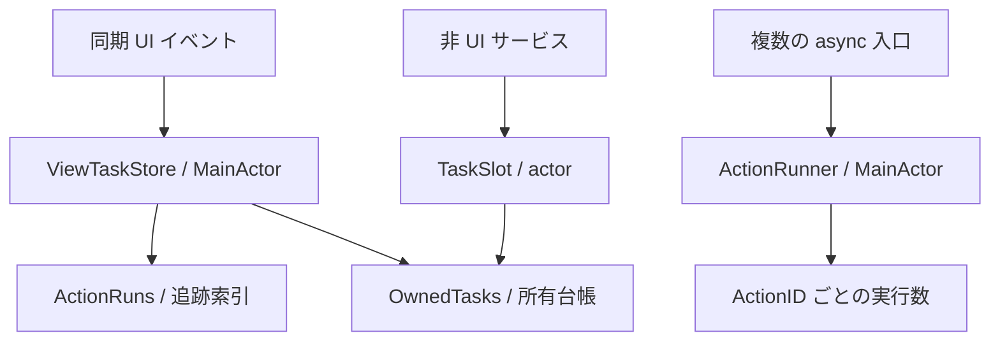

# アーキテクチャ

この文書は、Tasking の現行契約、設計根拠、内部不変条件の正本である。
用語は [用語集](glossary.md)、適用判断は [用途と設計原則](positioning.md)、公開保証は [リリース設計と運用](releasing.md) に定める。

## モジュールと隔離

`swift-tasking` は外部依存を持たない Swift package で、UI 向けの `Tasking` は非 UI 向けの `TaskingCore` に依存する。
どちらも同じバージョンのタグで配布する。

| 型 | 処理を実行するタスク | 隔離 | 管理する状態 |
|---|---|---|---|
| `Tasking.ViewTaskStore` | 自分で作成・所有 | MainActor | 受付、Action の追跡、任意のキャンセルグループ、未終了タスク |
| `Tasking.ActionRunner` | 呼び出し元のタスク | MainActor | Action ごとの実行数 |
| `TaskingCore.TaskSlot` | 自分で作成・所有 | 独立した actor | 受付、最大1つのアクティブなタスク、未終了タスク |

Store の処理本体は `@MainActor @Sendable () async throws -> Void`、
Runner は `@MainActor () async throws -> Success`、Slot は `@Sendable () async -> Void` を受け取る。
Runner は新しいタスクや actor 境界へ成功値を送らないため、`Success: Sendable` を要求しない。
UI の状態へ接続する管理を MainActor に置き、非 UI の所有には MainActor を要求しない構成である。

Swift tools 6.0 と Swift 6 言語モードを使い、利用側の機能モジュールも Swift 6 モードをサポート条件とする。
対応 OS は iOS 13、macOS 10.15、tvOS 13、watchOS 6、visionOS 1 以降である。
default actor isolation と `NonisolatedNonsendingByDefault` は有効にしない。
Swift 5 モードから import できることは、捕捉の安全性と対応を保証しない。
コンパイラ設定を変える場合は、処理本体の実行場所と最低ツールチェーンを再検証する。
`await` の記述だけで重い同期計算を MainActor から移すことはできない。

## ViewTaskStore の契約

### 受付・追跡・所有の状態

Store は受付状態と、追跡索引、所有台帳を持つ。追跡は選択キャンセルと同期照会に使い、
所有はキャンセル済みも含む実終了の確認と、既定の再入防止に使う。

| 操作 | 受付 | 対象の追跡 | 対象の所有 |
|---|---|---|---|
| 受理した `start` | 開いたまま | 追加 | 作成したタスクを追加 |
| `cancel(run)` / `cancel(id:)` / `cancel(group:)` | 変えない | 対象を解除 | キャンセルを要求し、実終了まで保持 |
| `cancelAll()` | 変えない | すべて解除 | 全所有タスクにキャンセルを要求し、実終了まで保持 |
| 処理本体の終了 | 変えない | その実行だけ解除 | そのタスクだけ解除 |
| `close()` | 恒久的に閉鎖 | 変えない | 変えない |

`start(id:group:policy:priority:operation:)` は同期メソッドで、任意のグループの既定値は `nil`、方針の既定値は `.ignoreNew`。
受付が閉じていれば方針の判定前に `.skipped(.closed)` を返し、拒否した要求は処理本体を呼ばない。
受理した要求は、処理本体が実行される前に追跡と所有の登録を完了し、`.started(ActionRun)` を返す。

### 開始方針と照会

| `TaskStartPolicy` | 同じ ActionID の実行への扱い |
|---|---|
| `.ignoreNew` | キャンセル済みを含め、未終了の実行が1つでもあれば `.skipped(.unfinished)` |
| `.cancelExisting` | 追跡中の実行を解除してキャンセルを要求し、実終了を待たず新規開始 |
| `.allowConcurrent` | 追加の実行を開始 |

グループが違っても、同じ ActionID は同じ受付単位となる。
既定値はキャンセル後も旧処理の実終了まで再入を防ぐ。非協調処理が新規要求を長く妨げる場合もあるため、
即時の差し替えには `.cancelExisting` を明示する。差し替えは副作用の巻き戻しや到着順の確定を保証しない。
すでに追跡解除された実行は `.cancelExisting` の再選択対象にはならないが、終了まで所有される。

| 照会 | 対象 |
|---|---|
| `isTracked(id:)` / `trackedCount(for:)` | ActionID の追跡 |
| `isTracked(_:)` | ActionRun の追跡 |
| `isTracked(group:)` / `trackedCount(group:)` | グループの追跡 |
| `unfinishedCount` | 所有中の未終了タスクの合計 |
| `unfinishedCount(for:)` | ActionID ごとの未終了件数 |
| `isUnfinished(_:)` | ActionRun の未終了状態 |

`isTracked == false` と `isUnfinished == true` は両立する。
個別の実行の選択には ActionID と ActionRunID の両方の一致を要求する。

`CancellationGroup` は文字列を保持する選択ラベルで、既定の寿命名を持たない。
通常は所有者ごとに Store を分け、終了イベントから `cancelAll()` を呼ぶ。
グループは、同じ Store 内の部分集合をまとめて選ぶ必要がある場合だけ使う。
グループは所有者の寿命を延ばさず、ライフサイクルイベントや OS のバックグラウンド実行権限も設定しない。

### 結果・表示・未処理エラー

業務結果、回復可能なエラー、進捗、再試行は ViewModel やサービスの状態で扱う。
Store と Runner は `Observable` / `ObservableObject` ではない。追跡や未終了件数の変化だけで SwiftUI は再描画されない。
表示の全終了経路を利用側で確定し、実行が重なる場合は結果と後処理を世代で保護する。
キャンセル済みの要求が遅れて入口へ到達しても新しい状態を変えないよう、世代や表示状態を更新する前にキャンセルを確認する。

Store は正常な return と `CancellationError` を通常の終了として扱う。
その他のエラーは処理本体からの漏れとして、任意の `onUnhandledError(ActionRun, any Error)` に元のエラーを渡す。
元の型を維持するため、通知先で型に応じたログや診断を選べる。業務上の回復は処理本体で行う。

通知先は MainActor 上で、完了による追跡・所有の解除より前に同期的に呼ぶ。
キャンセルで解除済みの追跡は復元しない。通知先がない場合や Store の解放後は Debug でアサーション、Release では通知しない。
Store は通知先を保持するため、通知先から所有者を参照する場合も弱参照を使う。

## ActionRunner の契約

`run(id:policy:operation:) async rethrows -> Success?` は ActionID ごとの実行数で受付を制御する。
`.ignoreNew` が既定値で、同じ ID の実行があれば `nil` を返す。`.allowConcurrent` は追加の実行を受理する。
スキップ時は処理本体を呼ばない。受理時は件数を増やし、呼び出し元のタスク内で実行し、return と throw の両方で件数を戻す。

成功すると `.some(value)` を返し、エラーと `CancellationError` は元の型のまま送出する。
成功値が Optional の場合も、スキップの `nil` と、受理して `nil` を返した `.some(nil)` を区別する。
キャンセル要求済みでも、処理が値を返した場合は `.some(value)` である。
エラーを投げない処理では、`rethrows` により呼び出し側にも `try` は不要になる。

Runner は Task の作成・所有、キャンセル、受付閉鎖を行わない。
呼び出し元のキャンセル状態、TaskLocal、優先度は同じタスクで維持される。
複数入口で受付を共有する場合だけ所有者に Runner を保持する。単一機能の状態ガードで足りる場合は通常の async を使う。

## TaskSlot の契約

`replace(priority:operation:)` はアクティブなタスクへキャンセルを要求し、新しいタスクを作成して `true` を返す。
閉鎖後は処理本体を呼ばず `false` を返す。
`cancel()` はアクティブなタスクにキャンセルを要求し、アクティブな対象を空にする。
差し替え済み・キャンセル済みのタスクも終了まで所有するため、未終了処理は複数存在し得る。

処理本体はエラーを外へ送出しない。業務エラー、キャンセル時の後処理、再試行、結果状態はサービスが持つ。
大量の入力は開始前にデバウンス・集約を検討する。Slot は要求のキュー、同時実行数の制限、最新結果だけの採用を提供しない。
Store と Slot は任意の `TaskPriority` を受け取り、`nil` は呼び出し元の優先度を継承する。

## キャンセルと終了待ち

処理本体は標準の `Task.checkCancellation()` / `Task.isCancelled` と、キャンセル対応 API で協調する。
キャンセルの確認と後処理は利用側がテストする。独立した `Task {}` は親子関係を作らないため、
処理内の並行実行には `async let` / task group を使う。

| 目的 | API |
|---|---|
| 同じ所有者を再利用してキャンセル | Store の `cancel(...)` / `cancelAll()`、Slot の `cancel()` |
| 受付を止め、受理済みの処理を完了させる | `close()` の後に `waitForIdle()` |
| 受付を止め、キャンセルを要求して実終了を待つ | `cancelAndWaitForIdle()` |
| Store の1回の実行を待つ | `awaitCompletion(of:)` |

`close()` は冪等な終端操作で、再開には新しいインスタンスを用意する。
`cancelAndWaitForIdle()` は最初の中断点より前に受付を閉じ、キャンセルを要求する。
受付が開いたままの `waitForIdle()` は、待機中に受理したタスクも含め、所有台帳が空になるまで待つ。
`awaitCompletion(of:)` はキャンセル済みも待つ。所有しない ActionID と ActionRunID の組、または終了済みの実行なら直ちに戻る。

待機側のキャンセルは対象タスクに伝播せず、待機も中断しない。処理が終了しなければ待機も完了しない。
終了 API の復帰は処理の終了を示し、業務結果の正しさや外部副作用の確定は利用側の状態・イベントで確認する。

### 自己待機

所有される処理が自分の実終了を待つことは、構造化子タスク経由も含めて契約違反である。
内部 TaskLocal に継承される所有文脈で検出し、Debug ではアサーションを発生させる。
Release の個別待機は直ちに戻り、全体待機は継承した所有文脈を除いてほかのタスクを待つ。
任意のタスク間の循環待機を検出・解決する機能ではなく、通常の制御フローに使わない。

## 内部構造と不変条件

| 内部の責務 | 保持する情報 |
|---|---|
| `ActionRuns<Metadata>` | Store の単一の追跡索引 `[ActionID: [ActionRunID: Metadata]]`。メタデータは任意のグループ |
| Store の未終了件数 | `[ActionID: Int]`。既定の再入判定と ID ごとの件数照会に使う |
| Runner の実行数 | `[ActionID: Int]`。個別 run の公開識別子や Task は作らない |
| `OwnedTasks<Key>` | タスクのハンドル、自己待機を判定する所有識別子 |
| `TaskOwnership` | 参照の一致で識別する不変の final class。台帳と TaskLocal が保持 |

- Store の追跡中の実行は必ず所有中である。
- ID ごとの未終了件数の合計は所有台帳の件数と一致し、キャンセルでは減らさず実終了時に減らす。
- 個別の実行は ActionID と ActionRunID の組で選ぶ。古い実行の終了はその実行だけを除く。
- 所有者の actor 上で終了処理が動く前に、所有台帳への登録を完了する。
- 台帳への可変アクセスを中断点をまたいで保持しない。
- 待機から復帰するたびに台帳を確認し、次に待つタスクを選ぶ。
- 内部タスクは所有者を弱参照し、エラー通知先は生存中の Store から取得する。

Store と Slot は解放時に全所有タスクへキャンセルを要求する。
利用側の処理が所有者を強参照すると解放を妨げるため、長い処理には必要な依存だけを捕捉する。
[利用レシピ](recipes.md#処理と所有者の参照関係を設計する) に参照構成を示す。

公開の `ActionRunID` は UUID に基づく。
内部の `TaskOwnership` は所有者から独立した参照で、乱数生成を要さず、TaskLocal に残る間はアドレスを再利用しない。
所有者自身のアドレスを使うと、解放後に残る所有文脈と再利用されたアドレスを区別できないため、この形にしている。

グループ用の追加索引は持たず、存在確認は最初の一致で返し、件数照会は全件を走査する。
追加索引は照会を速くする一方で全更新時の同期を増やすため、実利用で照会が支配的かを測って判断する。
所有文脈が空なら自己待機除外の走査を行わない。
台帳の内部表現は `@inlinable` / `@usableFromInline` で公開しない。速度の利益が明確でなければ内部表現を公開契約へ増やさない。
計算量と測定の条件・結果は [性能特性](performance.md) に定める。

## テスト方針

公開契約を Swift Testing で検証する。テストは入力と観測可能な結果から仕様を示す。

| 契約 | 観測点 |
|---|---|
| 受付と重複制御 | 受付結果、処理本体の呼び出し、追跡と未終了の違い |
| キャンセル | 処理本体が読むキャンセル状態、終了時の副作用 |
| 実終了待ち | ゲートを開くまでは待機し、復帰時には対象処理が終了していること |
| エラー | Store の元エラー通知、Runner の元エラー・キャンセル送出、Optional 成功と拒否の区別 |
| 参照の解放 | 弱参照、捕捉依存の解放、所有者解放時のキャンセル要求 |
| 表示状態 | キャンセル時の復旧、古い結果と後処理が新状態を上書きしないこと |

テスト用のゲートで処理の到達と再開を制御する。完了 API で実終了を確認し、追跡状態や短い sleep から推測しない。
Debug・Release・Thread Sanitizer・厳密な並行性チェックで、[本体](../Tests) と
[利用例](../Examples/TaskingPrototype/Tests/TaskingPrototypeTests) の契約を検証する。
性能は独立した Release ベンチマークで測り、正しさのテストに絶対時間のしきい値を置かない。
実行コマンドは [コントリビューションガイド](../CONTRIBUTING.md) を参照する。
