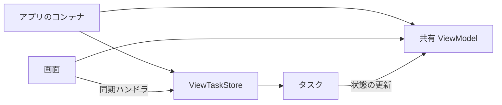

# 寿命と所有構成

処理を管理できる期間は、Store / Slot を保持する所有者の寿命で決まる。
まず所有者を配置し、その所有者の終了イベントをキャンセルや終了待ちへ接続する。

## 管理したい期間に Store を置く

| 範囲 | 所有者の例 | 終了イベントの例 |
|---|---|---|
| 1つの画面 | View または画面用コンテナ | 画面の非表示 |
| 1つのシーン | シーンのルート View またはコンテナ | シーンの破棄 |
| 画面を越える処理 | App が保持するコンテナ | ログアウト、サービスの終了 |
| 非 UI の差し替え可能な処理 | サービスが保持する Slot | サービスの終了 |

標準 `.task` の寿命で足りる処理には Store を追加しない。
Store が必要なら、通常は所有者ごとに分け、終了時は `cancelAll()` を使う。

## 画面の同期イベントから開始する

次は `SwiftUI` と `Tasking` を import した画面の例である。
`SettingsViewModel.save()` は表示状態・業務エラー・協調キャンセルを扱うアプリ側のメソッドである。

```swift
@MainActor
struct EditorView: View {
    @State private var store = ViewTaskStore()
    let viewModel: SettingsViewModel

    var body: some View {
        Button("保存") {
            store.start(id: "editor.save") { [viewModel] in
                try await viewModel.save()
            }
        }
        .onDisappear {
            store.cancelAll()
        }
    }
}
```

非表示時のキャンセルは受付を閉じないので、同じ Store を持つ画面を再表示できる。
既定の `.ignoreNew` はキャンセル済みの保存が実終了するまで次の要求を拒否する。
即時に差し替える場合だけ `.cancelExisting` を明示し、世代ガードや副作用の規則を設ける。
`close()` は終端操作なので、所有者を恒久的に終了する際に使う。

## シーンごとに所有を分ける

`WindowGroup` の各ルート View に Store を保持すると、ウィンドウごとに所有を分けられる。
子画面には必要な操作だけを公開する同期ハンドラを渡せる。
同じルートに属する機能でも、終了方針が独立していれば別の Store を配置する。

シーンの inactive 化と破棄を区別する。ダイアログや一時的なフォーカス喪失でも inactive になるため、
キャンセルすべき状態変化は処理の要件で決める。処理自身が起こしたシステム表示で `scenePhase` が変化する場合もある。

## 画面を越えて継続する

Store と表示用 ViewModel をアプリ側のコンテナに保持する。
画面は同じ ViewModel と同期ハンドラを受け取り、離脱後も続く処理の状態を、再表示時に参照できる。
[AppSyncFeature.swift](../Examples/TaskingPrototype/Sources/TaskingPrototype/AppSyncFeature.swift) の `AppTaskContainer` が実装例である。



画面は同期の起点であり、タスクの所有者にはしない。画面の `onDisappear` ではこの Store をキャンセルしない。
準備処理を1回だけ要求するなどの業務条件は、コンテナの準備状態として持つ。
`.ignoreNew` は未終了の重複を防ぐ方針であり、終了後の再要求は受け付ける。

## 部分集合が必要な場合だけグループを使う

`CancellationGroup` は同じ Store 内の追跡中の実行を選択するラベルである。
画面・シーン・アプリの組込みラベルは持たない。たとえばアカウント切替時に一部だけキャンセルする場合に使う。
以下は MainActor 上の同期ハンドラ内の断片で、`refreshProfile()` はアプリ側のエラー処理済み async メソッドである。

```swift
let accountGroup: CancellationGroup = "account"
store.start(id: "account.profile", group: accountGroup) {
    await refreshProfile()
}
store.cancel(group: accountGroup)
```

同じグループのキャンセルは、該当するすべての追跡中の実行に及ぶ。
別々の所有者を同じラベルで表す代わりに、Store の分割を先に検討する。
グループを付けても Store の寿命は延びず、OS のバックグラウンド実行権限も得られない。

## 所有者を終了する

| 所有者の扱い | 操作 |
|---|---|
| 同じ所有者を再利用 | 必要な対象に `cancel` / `cancelAll()` を要求 |
| 新規受付を止め、受理済みを完了させる | `close()` の後に `waitForIdle()` |
| 新規受付を止め、キャンセルして実終了を確認 | `cancelAndWaitForIdle()` |

Store と Slot は解放時もキャンセルを要求するが、参照関係によっては解放されない。
明確な終了時点が必要なら終了イベントから API を呼ぶ。
[参照構成](recipes.md#処理と所有者の参照関係を設計する) と [待機の契約](architecture.md#キャンセルと終了待ち) を確認する。

プロセス停止中や終了後の継続には、要件に合う OS のバックグラウンドタスクや転送 API を使う。
アプリ側の長い寿命は、その実行権限の代わりにはならない。
